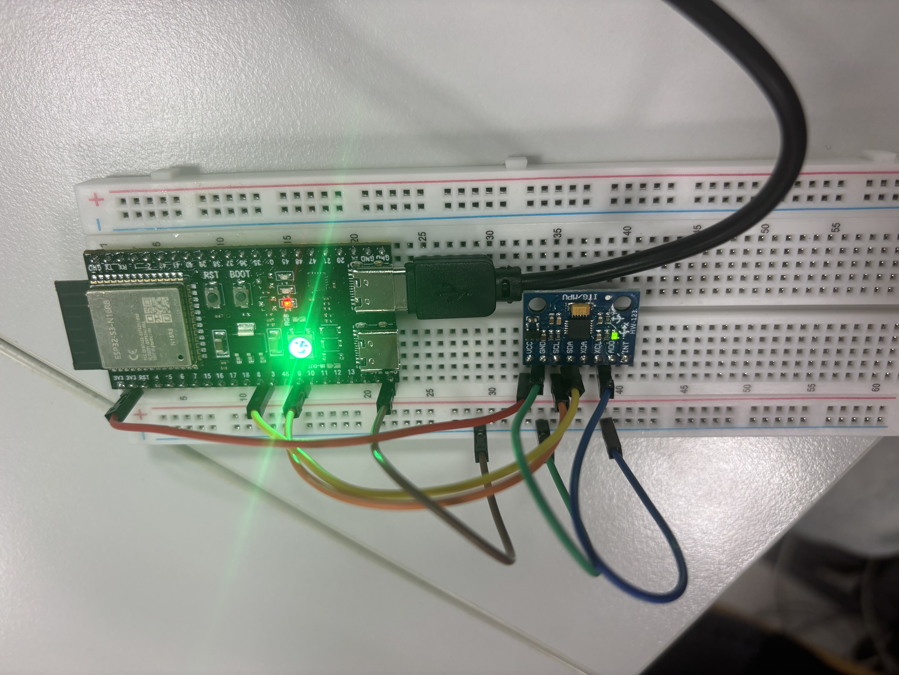

# HiJack breathing

**Authors:** Kateřina Hoffmannová and Adrian Jiřík

**Course:** Computer-Aided Medical Diagnostics (MPA-PRM), Application IV

**Assignment:** [Real-time AI on a microcontroller](https://tomasvicar.github.io/AUI-public/labs/real-time-ai.html)

An ESP32-S3 reads an MPU-6050 accelerometer and gyroscope and classifies four activities. Sampling, feature extraction and classification run on the board. A phone receives the result over Bluetooth Low Energy (BLE). A separate page served by the board provides live signals, class probabilities, a 3D orientation view and CSV recording.

| Class | Board LED and BLE screen | Measurement condition |
| --- | --- | --- |
| `not_attached` | Blue | Device lying still or held/moved slowly in the hand |
| `shaking` | Magenta | Device being shaken |
| `calm_breathing` | Green | Sensor held steadily against a calmly breathing chest |
| `fast_breathing` | Red | Same chest placement, with faster breathing |

## 1. Pages and connections

| Interface | Address / device | Connection | Purpose |
| --- | --- | --- | --- |
| BLE monitor | [adajirik.github.io/HiJack_breathing](https://adajirik.github.io/HiJack_breathing/) | Bluetooth device **HiJack-Detect** | Start/stop detection, matching screen colour, connection status and state history |
| Board dashboard | [http://192.168.4.1/](http://192.168.4.1/) | Wi-Fi **HiJack-Motion**, password **hijack32** | Signals, class probabilities, 3D orientation, calibration and CSV recording |
| Source repository | [AdaJirik/HiJack_breathing](https://github.com/AdaJirik/HiJack_breathing) | Internet | Firmware, training code, recordings, models and documentation |

The local board address works only while connected to its Wi-Fi. The BLE monitor is hosted over HTTPS and does not require joining that network. The board's plain HTTP page cannot use Web Bluetooth.

### Start detection over BLE

1. Power the ESP32 and enable Bluetooth on the phone.
2. Open the [BLE monitor](https://adajirik.github.io/HiJack_breathing/) in **Chrome on Android**. On **iPhone**, open the same URL in [Bluefy](https://apps.apple.com/app/id1492822055); Safari and Chrome on iPhone do not provide Web Bluetooth. Chrome or Edge on a BLE-capable Windows computer can also be used.
3. Press **Connect ESP32** and select **HiJack-Detect**. The page identifies the board by its advertised service UUID; pairing in phone settings is not required.
4. Press **Start detection**. Maintain the activity for at least four seconds while the first window fills. For breathing, keep the sensor steadily against the chest in the same placement used during recording.
5. The page and RGB LED show the same classified state. **Stop** stops classification and turns off the RGB LED. **Disconnect** closes BLE; detection continues on the board until stopped or reset.

Keep the monitor in the foreground. Notifications arrive on state changes and as a 200 ms heartbeat. After 1.5 seconds without fresh updates, the screen becomes neutral and raises a connection alarm. History contains the latest 20 state/alarm events and clears on reload. Refresh the monitor after firmware/page updates.

### BLE alarms and recommended limits

| Alarm | Default trigger |
| --- | --- |
| Fast breathing | **10 seconds** continuously classified as `fast_breathing` |
| Sensor not attached | **10 seconds** continuously classified as `not_attached` |
| Connection lost | Immediately on an unexpected BLE disconnect, or after **1.5 seconds** without fresh notifications |

The 10-second limits are lab-demo settings, not medical thresholds. They avoid alarming on a brief transition while keeping a demonstration short. The timer starts when the board reports the classified state, after windowing/smoothing; it does not measure time from the physical onset of an activity.

**Alarm settings** accepts whole-second limits from **1 to 300**. Press **Apply limits**; settings are saved in that browser when local storage is available. Each state has its own continuous episode: leaving it, stopping detection, a sensor fault or losing reliable BLE updates resets duration tracking. Reconnection starts a fresh episode. Warm-up does not count.

An active alarm shows a prominent banner and repeats a short two-tone sound every two seconds. Connect/Start enables browser audio; **Enable / test sound** lets the user check it. Keep the page open and the phone's media volume audible. **Mute this alarm** silences the current episode without hiding the warning; a new alarm episode sounds again. Alarms clear when their condition ends. The background continues to match the board LED while valid classifications arrive.

For a quick demonstration, temporarily set both limits to 3 seconds, trigger each state, then restore 10 seconds. To demonstrate connection loss, turn off the board or Bluetooth. The page's **Disconnect** button deliberately ends the session without alarming. Browser suspension or phone settings can prevent audible alerts; this remains a foreground coursework monitor.

### Open the Wi-Fi dashboard

1. Join **HiJack-Motion**, password **hijack32**.
2. Stay connected if the operating system reports that the network has no internet.
3. Open **http://192.168.4.1/** explicitly using HTTP.

The page shows acceleration, angular velocity, X/Y/Z movement traces, the 3D sensor model and four class probabilities. The **Gravity removed** trace becomes available after orientation calibration. Start detection through the BLE monitor to populate the classification panel. Wi-Fi and BLE can operate together.

## 2. Hardware and wiring

- **ESP32-S3 N16R8** development board: 16 MB flash and 8 MB PSRAM; this firmware does not use PSRAM.
- **MPU-6050** accelerometer/gyroscope breakout, GY-521 / HW-123 type.
- Breadboard, jumper wires and USB cable/power supply.
- Onboard addressable RGB LED, configured on **GPIO48**.



Disconnect USB power before changing wiring. Use printed pin labels rather than wire colours or breadboard row numbers.

| MPU-6050 pin | ESP32-S3 connection | Function |
| --- | --- | --- |
| VCC | **3V3** | Sensor-module power |
| GND | **GND** | Common ground |
| SDA | **GPIO8** | I²C data |
| SCL | **GPIO9** | I²C clock |
| AD0 | **GND** | Select I²C address `0x68` |
| XDA, XCL, INT | Unconnected | Not required by the polling implementation |

Both sensors are inside the same MPU-6050: all six axes use the same SDA/SCL pair. Breadboard holes in each five-hole row are connected; the centre gap separates the groups. Place each jumper in the same group/row as its intended pin.

The firmware uses **400 kHz I²C**, verifies the sensor identity and also tries address `0x69` if AD0 is high. Sensor settings are **±2 g acceleration**, **±250°/s angular velocity**, **44 Hz acceleration / 42 Hz gyro low-pass filtering**, and **100 Hz output rate**. GPIO signals use 3.3 V logic. A board revision with its RGB LED on GPIO38 requires changing `MOTION_RGB_PIN`; our configured board uses GPIO48.

Move the complete assembly together during measurement to avoid pulling on the sensor wires. USB can supply power during the demonstration; inference does not require USB data or computation on a computer.

## 3. Build and flash

The project uses **PlatformIO 6.2.0**, **Espressif32 platform 6.12.0** and **Arduino-ESP32 2.0.17**. `Wire`, Wi-Fi, HTTP and BLE come from the framework. The exported model does not need an external inference runtime.

From PowerShell:

```powershell
git clone https://github.com/AdaJirik/HiJack_breathing.git
cd HiJack_breathing
python -m venv .venv
.\.venv\Scripts\python.exe -m pip install platformio==6.2.0 pyserial==3.5
.\.venv\Scripts\python.exe -m serial.tools.list_ports -v
.\.venv\Scripts\python.exe -m platformio run -d firmware
.\.venv\Scripts\python.exe -m platformio run -d firmware -t upload --upload-port COM3
```

Use a data-capable USB cable and replace `COM3` with the detected port. COM3 was the CH343 USB-UART port on our computer. If no port appears, check the cable, USB-UART socket and driver. If automatic bootloader entry fails, hold **BOOT**, tap **RESET**, release **BOOT**, then retry.

The build configuration is [firmware/platformio.ini](firmware/platformio.ini). After flashing, use either interface above. Resetting clears orientation calibration, pending recordings and the detection state.

## 4. Data collection

[Data/](Data/) contains **40 recordings**, ten per class, each approximately **10 seconds** long: **39,999 samples** in total. One recording has 999 samples; the others have 1,000.

To record through the dashboard:

1. Select **Not attached**, **Shaking**, **Calm breathing** or **Fast breathing**.
2. Enter a filename, prepare the activity and press **Record 10 seconds**. Capture starts immediately.
3. Maintain that activity during the countdown. The ESP32 captures all six axes independently of browser updates.
4. When **Keep this measurement?** appears, select **Confirm & save CSV** or **Discard**.

The filename is the provided base followed by the class, for example `session01_calm_breathing.csv`. There is no random suffix, and the class is not repeated in each data row. The browser handles the download. Only one capture is retained in board RAM; save it before another capture or power-off. A sensor-read failure invalidates the recording.

```text
timestamp_us,ax_m_s2,ay_m_s2,az_m_s2,gx_deg_s,gy_deg_s,gz_deg_s,session_id,sample_index,device_sample_seq,calibrated,accel_scale
```

`timestamp_us` is relative to capture start. Acceleration is in **m/s²**, including gravity; angular velocity is in **degrees/s**. These are sensor-frame values without the 3D view's gain correction or gyro-bias subtraction. `session_id` identifies the recording; indices help inspect continuity. `calibrated` and `accel_scale` preserve visualization-calibration context, but that gain is not applied to the stored axes.

Detached examples include a stationary device and slow hand movement. Breathing examples use steady chest contact; shaking examples use deliberate shaking. Labels describe the recorded activity rather than a clinical breathing-rate threshold. The dataset does not contain subject IDs or an independent new-person evaluation.

## 5. Classifier and features

The active classifier is a **multilayer perceptron (MLP)**: **24 inputs → 16 hidden units → 4 outputs**, with **468 learned parameters**. Hidden units use **ReLU** and outputs use **softmax**. Output order is `not_attached`, `shaking`, `calm_breathing`, `fast_breathing`.

Each window of six-axis raw data is reduced to 24 features:

| Feature group | Count | Information represented |
| --- | ---: | --- |
| Combined XYZ acceleration and gyro standard deviations; acceleration-magnitude standard deviation; acceleration and gyro successive-sample difference RMS; gyro RMS | 6 | Motion amplitude and how quickly it changes |
| Standard deviation of each acceleration and gyro axis | 6 | Axis-dependent motion and chest tilt |
| Acceleration and gyro power at **0.15, 0.25, 0.4, 0.6, 0.9 and 1.2 Hz**, summed across each sensor's three axes | 12 | Low-frequency breathing patterns |

Amplitude features use `log(1 + value)`. Spectral features use `log(1 + power)` after signal centering and a Hann window. All features are standardized using fitted training means and scales. Python computes spectral powers through Fourier projections; the ESP32 uses equivalent Goertzel calculations.

[four_state_model.h](firmware/include/four_state_model.h) contains exported normalization, weights and biases. [four_state.h](firmware/include/four_state.h) implements features and online decisions. The model uses raw data: **level calibration is not required for classification or recording**. Softmax outputs are model probabilities, not verified clinical confidence estimates.

### Detection window and timing

| Quantity | Setting |
| --- | --- |
| Sampling rate | **100 Hz** |
| Classification window | **400 samples = 4 seconds** |
| Window advance | **50 samples = 0.5 seconds** |
| Overlap | **87.5%** |
| First result | After a complete four-second window |
| Probability smoothing | Exponential average, weight **0.5** for the new output |
| State switching | Two consecutive new-class winners |

Transitions are not instantaneous: the window initially contains the previous activity, and smoothing adds delay. Maintain each activity for several seconds during a demonstration. Four seconds captures low-frequency structure but may contain only part of a slow breath. The program does not estimate breaths per minute.

## 6. Model training

From the repository root:

```powershell
.\.venv\Scripts\python.exe -m pip install -r training/requirements.txt
.\.venv\Scripts\python.exe training/train_four_state.py
```

Training uses **NumPy 2.2.6** and **scikit-learn 1.7.2**. The pipeline:

1. Reads filename labels and validates samples, timestamps, rate and duplicate recordings.
2. Splits **complete recordings before creating overlapping windows**, using seed **42**: 24 initial training, 8 validation and 8 test recordings.
3. Compares multinomial logistic regression and 16/24-unit MLPs using four-fold recording-group cross-validation on the **32 development recordings**. Each fold fits its own normalization.
4. Selects the **16-unit MLP**, trained with L-BFGS and L2 regularization (`alpha=0.5`). The larger network ties its development score without improving it.
5. Fits the selected model on the 32 development recordings and evaluates the eight excluded test recordings.
6. Saves the reports, split, source hashes, parameters, reference windows and generated C++ header.

The eight test recordings are excluded from the deployed weights. After retraining, rebuild and flash the firmware. The earlier two-class pipeline remains in [train_movement.py](training/train_movement.py); the current pipeline is [train_four_state.py](training/train_four_state.py).

## 7. Results and limitations

The eight held-out recordings, two per class, produce **104 overlapping windows**. Window accuracy is **100%** and macro-F1 is **1.0**. Rows are actual classes; columns are predictions.

| Actual / predicted | Not attached | Shaking | Calm breathing | Fast breathing |
| --- | ---: | ---: | ---: | ---: |
| Not attached | 26 | 0 | 0 | 0 |
| Shaking | 0 | 26 | 0 | 0 |
| Calm breathing | 0 | 0 | 26 | 0 |
| Fast breathing | 0 | 0 | 0 | 26 |

These results concern our recordings. Overlapping windows are not independent trials; development cross-validation macro-F1 varies from approximately **0.81 to 1.0**. Performance on new people, remounted sensors and continuous transitions has not been established. Some shaking samples reach the ±2 g / ±250°/s sensor limits. Changing ranges would require compatible training data.

Hardware checks verified BLE Start/Stop and live colour notifications, fresh sensor readings without I²C errors, and approximately **99.9 Hz** sampling during classification. Feature extraction plus inference took about **41.8 ms** in an observed run. Sampling runs on core 1; classification runs separately on core 0, outside the sample-buffer lock, so it does not block CSV capture. The final build uses approximately **124 kB static RAM** and **1.42 MB flash**.

Native tests compare four-class C++ probabilities with Python within **0.0001**, and check LED mapping, buffer order, startup, stop and fault recovery. Browser-script tests cover the dashboard, recording confirmation, BLE colours, history and disconnected/stale states. Actual chest-mounted performance still needs a live demonstration with the intended placement.

See the [evaluation report](models/four_state_report.json), [recording split](models/four_state_split.json), [data quality](models/four_state_data_quality.json) and [training details](training/FOUR_STATE.md). This is a coursework prototype, not a clinical monitor; it has no explicit unknown-activity class.

## 8. Own extension: 3D motion and recording workstation

The assignment requires a signal/prediction page. Our extension adds a **motion visualization and data-collection workstation** to that page:

- A 3D sensor model follows estimated orientation, with roll, pitch and yaw values.
- **Calibrate level** establishes a horizontal reference, stationary gyro bias and uniform gravity-scale correction. Lay the sensor flat, component side up, and leave it still for approximately **3.1 seconds** after pressing the button.
- Gravity-compensated acceleration appears as a direction arrow, signed values, movement intensity and a time trace. Raw XYZ traces are available before calibration.
- Activity selection, custom filenames, capture progress, confirmation/discard and CSV export allow collecting ten-second training examples without a separate serial logger.

Orientation fusion runs on the ESP32; the browser renders the 3D geometry. Gravity constrains roll and pitch, but yaw drifts without a magnetometer. The display shows **orientation and acceleration**, not reconstructed position, distance or travel direction. Calibration affects visualization; classification and exported raw samples remain independent of it.

## 9. Verification and troubleshooting

From the repository root:

```powershell
node tools/check_dashboard.cjs
node tools/check_ble_monitor.cjs
node tools/check_alarms.cjs
.\.venv\Scripts\python.exe tools/inspect_device.py COM3
.\.venv\Scripts\python.exe tools/inspect_detection.py
```

The first three commands check browser scripts and alarm timing without hardware. The diagnostic scripts inspect the connected board; `inspect_detection.py` temporarily starts detection and stops it afterwards. These are development tools, not part of the standalone demonstration. Native tests in [check_four_state.cpp](tools/check_four_state.cpp) and [check_recorder.cpp](tools/check_recorder.cpp) can be built with a C++17 compiler and `firmware/include` on the include path, then run from the repository root. [inspect_ble.py](tools/inspect_ble.py) provides an optional real BLE test and requires `bleak==2.0.0`.

| Problem | Check |
| --- | --- |
| Local page does not open | Join **HiJack-Motion**, remain connected despite the no-internet warning, and use **http://192.168.4.1/** |
| BLE connection fails | Enable Bluetooth, use Android Chrome or iPhone Bluefy, load the HTTPS monitor and disconnect another client if necessary |
| Page rejects a new state | Refresh the monitor so its script matches the firmware |
| No classification yet | Press Start and allow four seconds; sensor faults restart warm-up |
| Breathing is unstable | Keep steady chest contact, match the recorded placement and allow the window to settle |
| Calibration fails | Keep the sensor flat, component side up and still; ordinary noise is tolerated |
| 3D heading drifts | Recalibrate; yaw has no compass reference |
| CSV disappears after reset | Captures are in RAM; confirm and download before power-off |

## 10. Assignment coverage and remaining checks

| Assignment part | Implemented evidence |
| --- | --- |
| Movement versus shaking | On-board classifier; blue/magenta LED and BLE screen |
| Breathing | Four-state MLP; green/red breathing states and class probabilities |
| BLE monitor | HTTPS page, Start/Stop, matching colour, timestamped history, configurable fast-breathing/not-attached duration alarms and connection-loss alarms |
| Board web page | Wi-Fi hotspot, measured signals, prediction and four class probabilities |
| Own extension | Calibrated 3D orientation, acceleration visualization and confirmed CSV recording |
| Documentation | Team, wiring/photo, connection instructions, build/flash, collection/training, results and AI use |

The required duration and connection-loss alarms are implemented in the BLE page, with visible warnings and browser-generated sound. Their timing, reset, mute and reconnection behavior are covered by automated tests. Phone-specific audible behavior and the complete live demonstration must still be checked on the intended devices.

Before submission, verify access for GitHub user **`tomasvicar`**, the minimum of **three intermediate commits pushed during the lab**, and live demonstration of each completed part to the teacher. Git history records implementation milestones; repository access and live demonstrations must be checked separately.

## 11. Repository contents

| Path | Contents |
| --- | --- |
| [firmware/](firmware/) | PlatformIO project, sampling, inference, calibration, HTTP page, recorder and BLE |
| [Data/](Data/) | Original CSV recordings |
| [training/](training/) | Training/export scripts and model documentation |
| [models/](models/) | Evaluation, splits, quality reports, parameters and reference windows |
| [monitor/](monitor/) | Static BLE monitor deployed through GitHub Pages |
| [tools/](tools/) | Native/browser checks and hardware diagnostics |
| [docs/wiring.jpeg](docs/wiring.jpeg) | Wiring photograph |

[monitor-pages.yml](.github/workflows/monitor-pages.yml) publishes only the `monitor/` directory. Firmware builds and training run locally.

## 12. Use of AI tools

**Codex (OpenAI)** assisted with planning, firmware and interface implementation, feature extraction, training/export code, tests, debugging and documentation. Training and evaluation ran locally on the project's recorded data; reports are saved in the repository. Both group members are responsible for understanding and explaining the submitted code, model and limitations, as required by the assignment.
